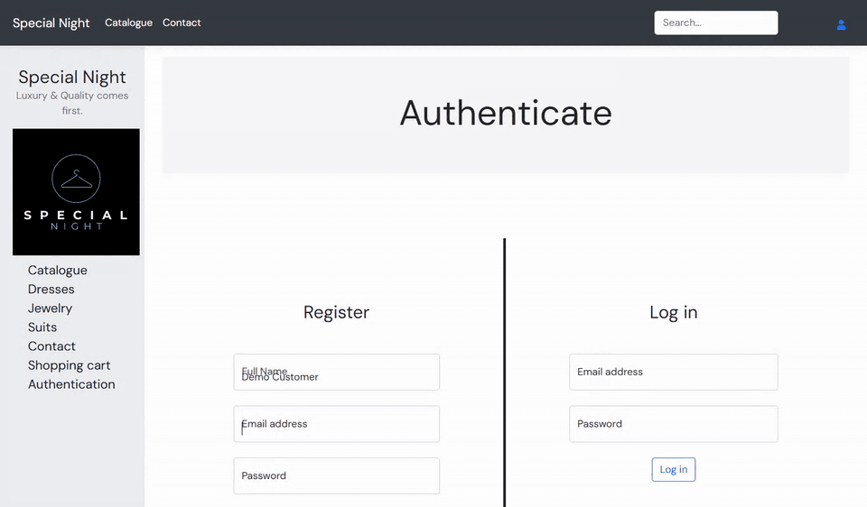
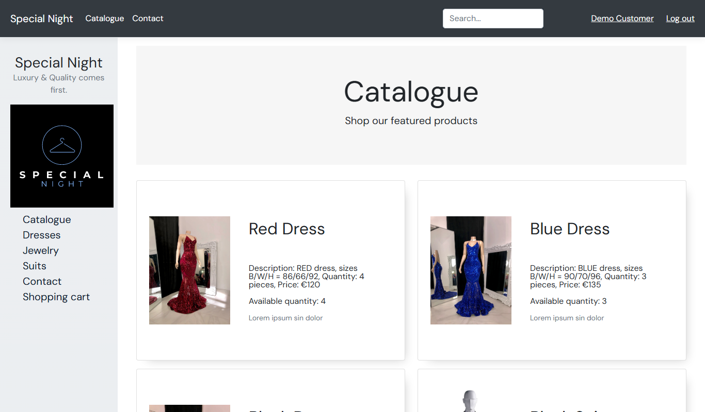
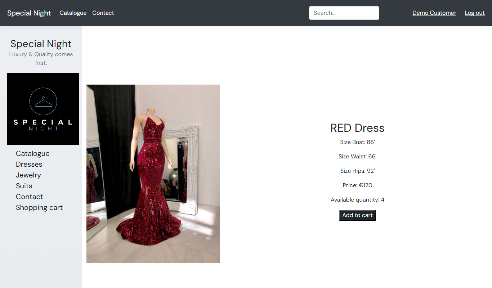
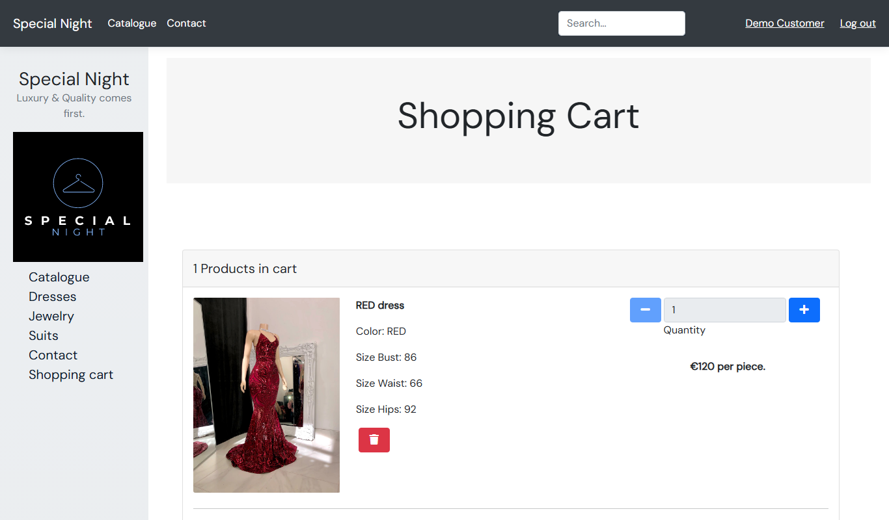
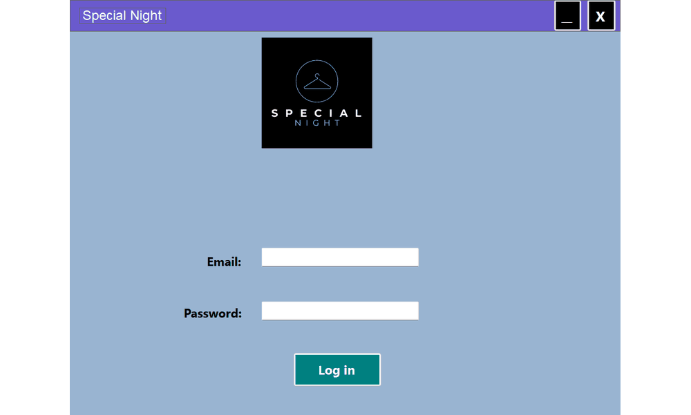
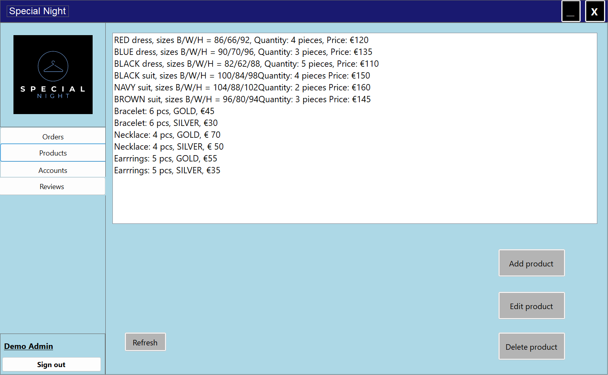
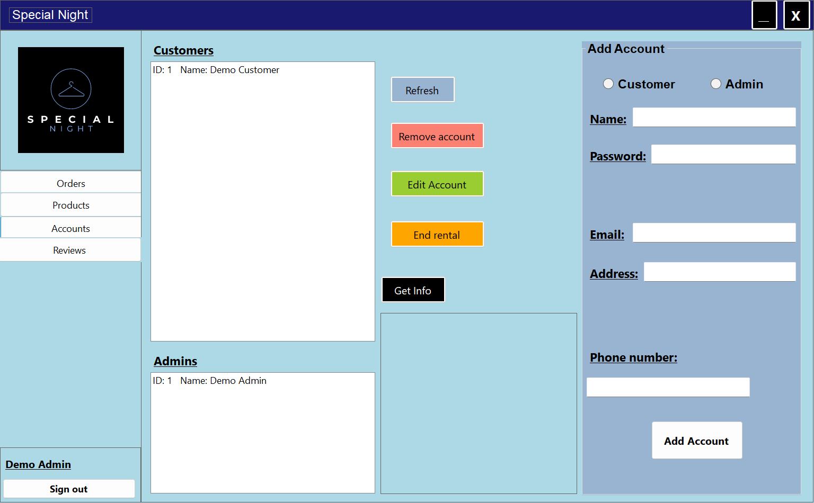
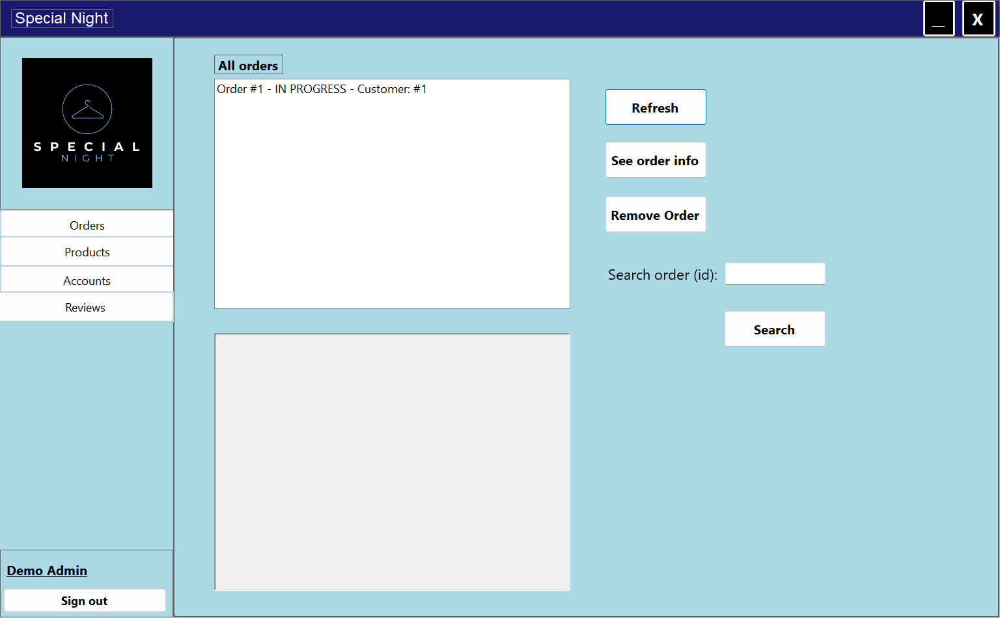
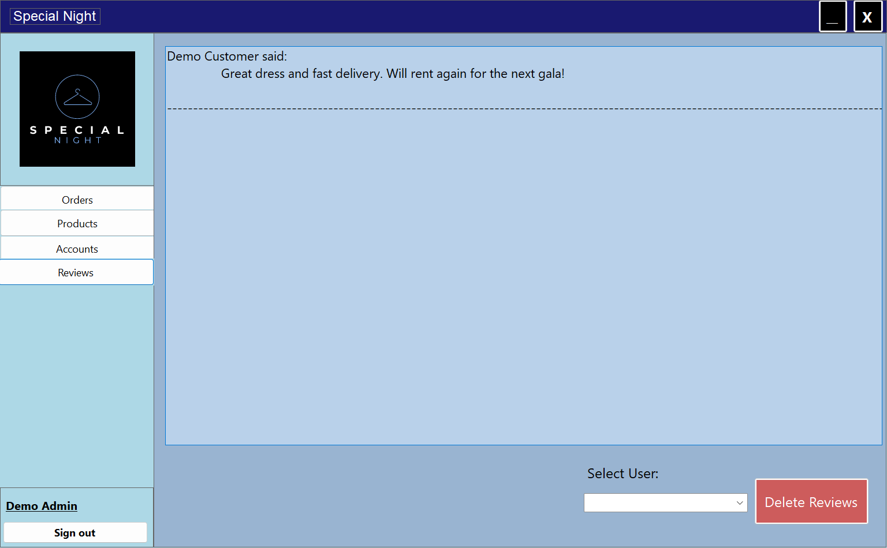
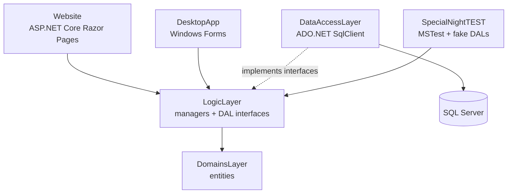

# Special Night: clothing rental shop (ASP.NET Core Razor Pages + WinForms)

A C# / .NET 6 project for a fictional rental shop for evening wear (dresses, suits, jewelry): a customer website built with ASP.NET Core Razor Pages, a Windows Forms desktop app for staff, and a shared logic and data access layer on SQL Server.



> Recorded on my machine with the unchanged code running against a local demo database (see "How to run it" for why it had to be recreated).

Individual project from my second semester of software engineering (2023).

## The problem

The semester assignment: build one system with two front ends for two kinds of users. Customers browse and rent outfits on a website; staff manage the stock, accounts, orders and reviews from a desktop app. Both must share the same business rules and data, so the logic cannot live inside either user interface.

## What it does

**Website (customers, Razor Pages)**
- landing page, contact page, catalogue split into dresses, suits and jewelry, product details, search
- register and log in (cookie authentication, session)
- shopping cart (add, increase/decrease quantity, remove), place an order, order confirmation
- profile page; logged-in customers can write reviews

**Desktop app (staff, WinForms)**
- log in as admin
- manage products, customer and admin accounts, orders and reviews

**Shared**
- passwords stored as BCrypt hashes with an extra random salt
- product types modelled with inheritance: `Product` → `Dress`, `Suit`, `Jewelry` → `Bracelet`, `Earring`, `Necklace`

| Catalogue | Product details | Shopping cart |
|---|---|---|
|  |  |  |

### Desktop app for staff



| Products | Accounts | Orders | Reviews |
|---|---|---|---|
|  |  |  |  |

## Architecture



- **Layers in separate projects:** `DomainsLayer` (entities), `Libraries`/LogicLayer (managers such as `AccountManager`, `ProductManager`, `OrderManager`, `ShoppingCartManager`, `ReviewManager`, plus the DAL interfaces), `DataAccessLayer` (SQL queries), and two front ends. The logic layer depends on interfaces, not on the database code.
- **Testable without a database:** the test project swaps the real DAL for fake in-memory DALs. **44 unit tests (MSTest), all passing** when I ran them in a .NET 6 SDK container.
- UML class diagrams for each layer are included (`*.cd` files, Visual Studio class designer).

## Tech stack

C# / .NET 6, ASP.NET Core Razor Pages, Windows Forms, ADO.NET (`System.Data.SqlClient`), SQL Server, BCrypt.Net, MSTest, Bootstrap. An ElasticEmail client is referenced for order emails; the example code is in `Website/ElasticAPI.cs` and the calls in `OrderManager` are commented out.

## How to run it

During the semester the project used a SQL Server database on the university's server, which I no longer have. The schema was never part of the code, so for this repository I recreated it from the queries in `DataAccessLayer/DALs/`: [`demo-database/schema-and-demo-data.sql`](demo-database/schema-and-demo-data.sql) (tables plus a few demo products; added for this repo, not part of the original project). The screenshots and GIFs above were made with it.

Requirements: .NET 6 runtime or newer SDK, SQL Server (for example the official Docker image), Windows for the desktop app.

```bash
# 1. Database
docker run -d -p 1433:1433 -e ACCEPT_EULA=Y -e MSSQL_SA_PASSWORD=<choose-one> mcr.microsoft.com/mssql/server:2022-latest
#    then run demo-database/schema-and-demo-data.sql against it (sqlcmd, Azure Data Studio, ...)

# 2. Put your connection string in DataAccessLayer/DataAccessLayer.cs (it is a placeholder in this repo)

# 3. Run
dotnet test SpecialNightTEST/SpecialNightTEST.csproj     # 44 tests, no database needed
dotnet run --project Website/Website.csproj             # customer website
dotnet run --project DesktopApp/DesktopApp.csproj       # staff app (Windows)
```

Register a customer on the website. There is no sign-up for staff: copy a registered account into the `Admin` table to log in to the desktop app.

## My contribution

Individual project: I wrote all of it. The original repository has 97 commits, all mine (Feb to Nov 2023). This repository starts with a fresh history.

**About this repository:** the code is mine and has not been changed since 2023. I packaged it for GitHub (this README, the recreated demo database script, screenshots, GIFs, removing secrets) with help from an AI assistant, which is why the commits list Claude as co-author.

## Status and limitations

- Semester project, not a product; the shop and its texts are fictional.
- The connection string is hard-coded instead of coming from configuration, and the original project had no database schema or seed script.
- Some queries are parameterized (`@Email`, `@Price`), but many build SQL with string interpolation (for example product updates and shopping cart changes), which is open to SQL injection.
- Errors from the database are not handled: when the database is unreachable, pages that query it return HTTP 500 instead of a friendly message.

## What I would change for production

- Connection string in `appsettings.json` / environment variables, and Entity Framework Core migrations so the database can be recreated.
- Parameterized queries everywhere (or EF Core) to remove the SQL injection risk.
- ASP.NET Core Identity instead of the hand-written account handling.
- Integration tests against a real database in CI, and a Docker Compose setup with SQL Server for local runs.
