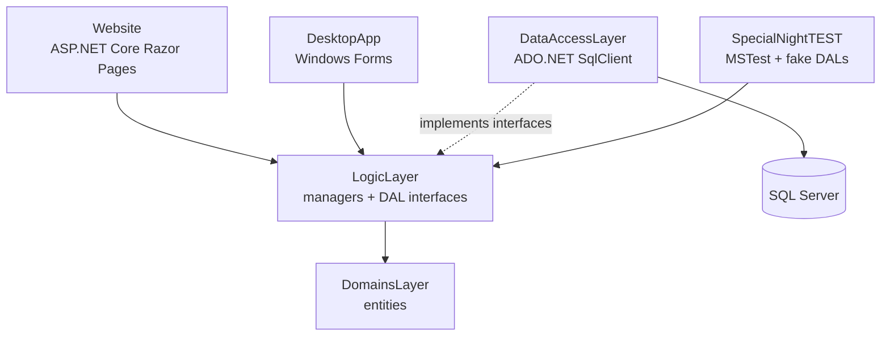
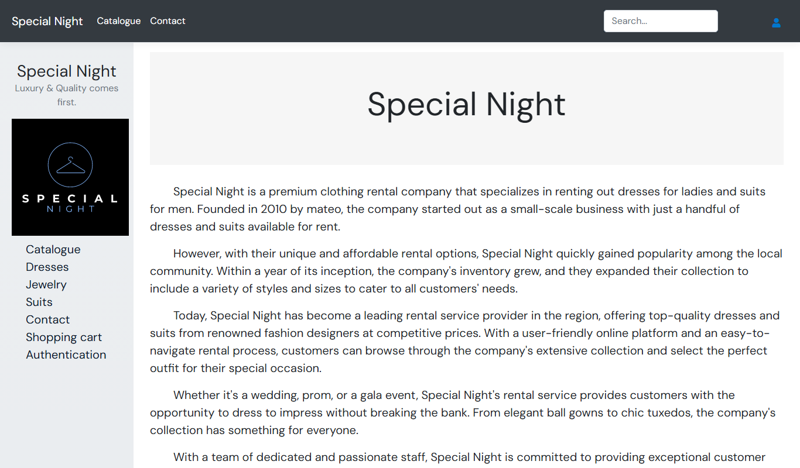
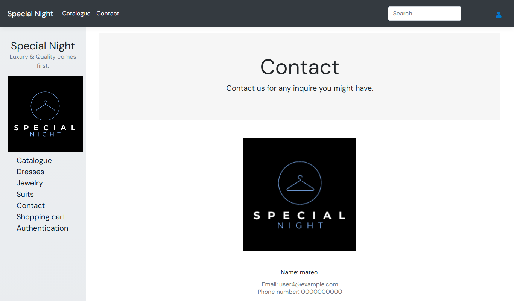
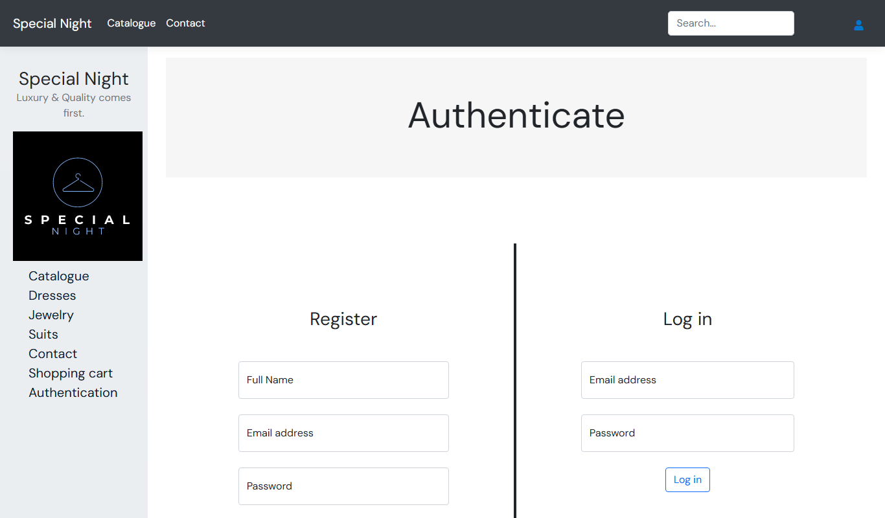

# Special Night: clothing rental shop (ASP.NET Core Razor Pages + WinForms)

A C# / .NET 6 project for a fictional rental shop for evening wear (dresses, suits, jewelry): a customer website built with ASP.NET Core Razor Pages, a Windows Forms desktop app for staff, and a shared logic and data access layer on SQL Server.


> Recorded on my machine with the website running unchanged in a .NET 6 container. The pages that list products need the SQL Server database the project used during the semester, which is not part of this repo (see "How to run it"), so the GIF shows only the pages that work without it.

Individual project from my second semester of software engineering (2023).

## The problem

The semester assignment: build one system with two front ends for two kinds of users. Customers browse and rent outfits on a website; staff manage the stock, accounts, orders and reviews from a desktop app. Both must share the same business rules and data, so the logic cannot live inside either user interface.

## What it does

**Website (customers, Razor Pages)**
- landing page, contact page, catalogue split into dresses, suits and jewelry, product details, search
- register and log in (cookie authentication, session)
- shopping cart (add, increase/decrease quantity, remove), place an order, order confirmation
- profile page; logged-in customers can write reviews

**Desktop app (staff, WinForms)**
- log in as admin
- manage products, customer accounts, orders and reviews

**Shared**
- passwords stored as BCrypt hashes with an extra random salt
- product types modelled with inheritance: `Product` → `Dress`, `Suit`, `Jewelry` → `Bracelet`, `Earring`, `Necklace`

## Architecture



- **Layers in separate projects:** `DomainsLayer` (entities), `Libraries`/LogicLayer (managers such as `AccountManager`, `ProductManager`, `OrderManager`, `ShoppingCartManager`, `ReviewManager`, plus the DAL interfaces), `DataAccessLayer` (SQL queries), and two front ends. The logic layer depends on interfaces, not on the database code.
- **Testable without a database:** the test project swaps the real DAL for fake in-memory DALs. **44 unit tests (MSTest), all passing** when I ran them in a .NET 6 SDK container.
- UML class diagrams for each layer are included (`*.cd` files, Visual Studio class designer).

| Landing page | Contact | Login / register |
|---|---|---|
|  |  |  |

## Tech stack

C# / .NET 6, ASP.NET Core Razor Pages, Windows Forms, ADO.NET (`System.Data.SqlClient`), SQL Server, BCrypt.Net, MSTest, Bootstrap. An ElasticEmail client is referenced for order emails; the example code is in `Website/ElasticAPI.cs` and the calls in `OrderManager` are commented out.

## How to run it

Requirements: .NET 6 SDK (the desktop app needs Windows).

```bash
dotnet test SpecialNightTEST/SpecialNightTEST.csproj     # 44 tests, no database needed
dotnet run --project Website/Website.csproj             # http://localhost:5000
```

The website starts and the landing, contact and login pages work. Everything that reads products, accounts or orders needs SQL Server:
- the connection string is hard-coded in `DataAccessLayer/DataAccessLayer.cs`; in this repo it is a placeholder (the original pointed to the database server I used during the semester)
- there is no schema script in the repository; the tables (`Product`, `Dress`, `Suit`, `Bracelet`, `Earrings`, `Necklace`, `Customer`, `Admin`, `Orders`, `OrderLine`, `ShoppingCart`, reviews) can be read from the queries in `DataAccessLayer/DALs/`

So I could not record the catalogue, cart or desktop app without changing code or rebuilding the database, and this repo shows the project as it was.

## My contribution

Individual project: I wrote all of it. The original repository has 97 commits, all mine (Feb to Nov 2023). This repository starts with a fresh history.

**About this repository:** the code is mine and is shown as it was in 2023. I packaged it for GitHub (this README, screenshots, demo GIF, removing secrets) with help from an AI assistant, which is why the single commit lists Claude as co-author.

## Status and limitations

- Semester project, not a product; the shop and its texts are fictional.
- The connection string is hard-coded instead of coming from configuration, and there is no database schema or seed script.
- Some queries are parameterized (`@Email`, `@Price`), but many build SQL with string interpolation (for example product updates and shopping cart changes), which is open to SQL injection.
- Errors from the database are not handled: without a database, pages that query it return HTTP 500 instead of a friendly message.

## What I would change for production

- Connection string in `appsettings.json` / environment variables, and Entity Framework Core migrations (or at least a schema script) so the database can be recreated.
- Parameterized queries everywhere (or EF Core) to remove the SQL injection risk.
- ASP.NET Core Identity instead of the hand-written account handling.
- Integration tests against a real database in CI, and a Docker Compose setup with SQL Server for local runs.
